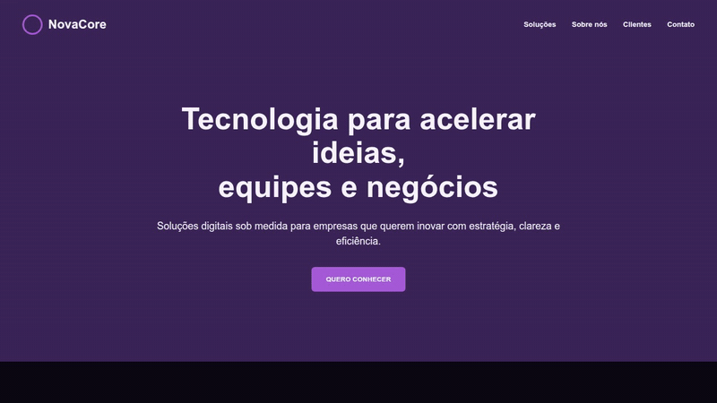
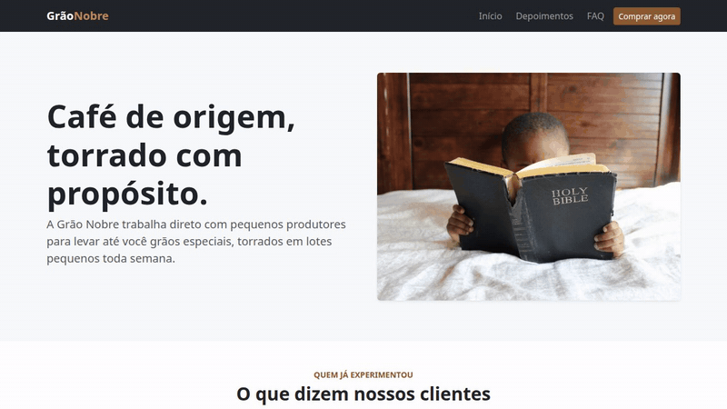
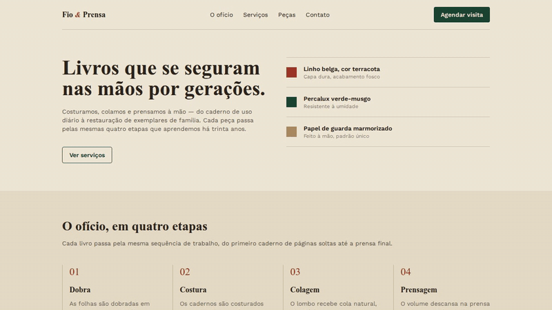
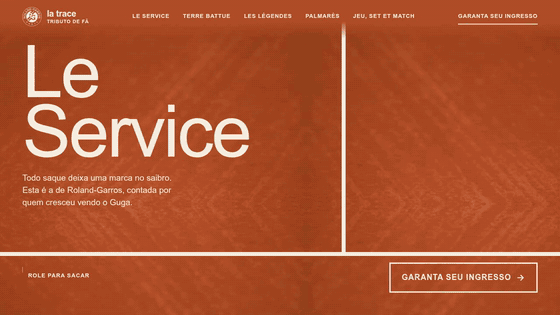

# Checkpoint 5 · Front-End Design

Repositório único com as quatro atividades feitas nas últimas semanas, cada uma baseada num material visto em aula:
**revisão, Bootstrap, Tailwind e vibecode**.

- **Disciplina:** Front-End Design, 1ES, 2026 (FIAP)
- **Professora:** Cyntia Sayuri
- **Aluno:** Henrique Bueno, RM 570591 (desenvolvimento individual)

Seguindo a regra do checkpoint, as três primeiras atividades foram feitas **sem IA**. IA só foi usada na última, a de
vibecode.

| Pasta | Atividade | Página | Tecnologias |
| --- | --- | --- | --- |
| [`revisao/`](revisao/) | Revisão | NovaCore, empresa de tecnologia | HTML + CSS puro |
| [`bootstrap/`](bootstrap/) | Bootstrap | Grão Nobre, café especial | Bootstrap 5.3 (CDN) |
| [`tailwind/`](tailwind/) | Tailwind | Fio & Prensa, ateliê artesanal | Tailwind CSS 4 (CDN) |
| [`AI/`](AI/) | Vibecode | La Trace, tributo a Roland-Garros | Vite, GSAP, Lenis, Vitest, Playwright |

## 1. Revisão: NovaCore

Landing page institucional feita só com HTML e CSS, para revisar a base antes dos frameworks.



- Hero com navegação, seções de **Serviços** (cards), **Sobre nós**, **Depoimentos** e **Contato** com formulário,
  além do rodapé.
- Layout com Flexbox e Grid, tipografia do Google Fonts (Inter e Poppins) e ilustrações SVG em `revisao/assets/`.

## 2. Bootstrap: Grão Nobre

Página de uma marca de café montada com os componentes do Bootstrap 5.



- **Navbar** responsiva com menu colapsável e fixa no topo.
- **Carrossel** de depoimentos, **accordion** de perguntas frequentes e **modal** com o formulário de pedido.
- Utilitários de espaçamento e grid do Bootstrap, com um `style.css` curto só para as cores da marca.

## 3. Tailwind: Fio & Prensa

Página de um ateliê de encadernação e tipografia, estilizada com classes utilitárias do Tailwind CSS 4.



- Tema próprio declarado em `@theme` (paleta papel, tinta e verde; fontes Fraunces e Work Sans).
- Seções de início, **o ofício em quatro etapas**, **peças recentes** em grid e rodapé de contato.
- Responsividade com os prefixos `md:` e `lg:`.

## 4. Vibecode: La Trace (Roland-Garros)

Landing page-tributo a Roland-Garros feita com IA (Claude Code e skills). Um saque real, quadro a quadro, é
conduzido pelo scroll e abre uma narrativa pelo saibro, pela história e pelas lendas do torneio, com o Guga como ponto
emocional.

**Deploy:** [cp-front-tenis.vercel.app](https://cp-front-tenis.vercel.app/)



- Parallax e animações com **GSAP ScrollTrigger**, rolagem suave com **Lenis** e build com **Vite**.
- **Tela de carregamento** com o logo de Roland-Garros em giz: a página carrega em segundo plano, em duas levas, para
  o início não travar.
- **Uma bola só:** a bola do saque desce a página inteira deixando um traço de giz e marcas no saibro. As marcas
  acompanham a bola: somem quando você rola para cima e renascem quando ela passa de novo.
- **Cursor-raquete** no computador: a raquete rebate a bola do rali.
- Testes de lógica com **Vitest** e testes end-to-end com **Playwright** (`AI/tests/e2e/`).
- Versão leve no celular e respeito ao `prefers-reduced-motion`.

### Le Mur: o joguinho do fim da página

Depois do ingresso, a mesma bola salta para o **Le Mur**, um paredão contra a gravidade: a bola, vista de lado, sobe e
cai no saibro, e você a mantém no ar.

- **Regras do tênis:** depois da rebatida a bola pode quicar uma vez; dois quiques seguidos ou bola fora pela lateral é
  erro, e três erros encerram a partida. O placar é o total de rebatidas, e o recorde fica salvo no navegador.
- **Três formas de jogar:** encostar a raquete na bola (computador), tocar perto dela (celular) ou apertar espaço no
  botão "Jogar" (teclado).
- **Contato e dificuldade:** o centro das cordas manda a bola alto e reta, a borda manda baixa e para o lado, e subir o
  mouse ao encostar dá força. A cada 5 rebatidas o jogo acelera.
- **Saibro que conta a partida:** cada quique válido deixa uma marca, e os erros aparecem como três ovais que se
  preenchem.
- **Som sintetizado** com a Web Audio API (rebatida, quique, erro e torcida no recorde), sem arquivos de áudio e com
  botão para silenciar.
- A partida **pausa** quando o jogo sai da tela ou quando a bola volta ao rali. Com `prefers-reduced-motion`, o Le Mur
  fica parado e mostra o recorde.
- As regras ficam num módulo sem DOM (`AI/src/le-mur-rules.js`), escrito com testes no Vitest; os comportamentos na
  página têm testes no Playwright, incluindo um que confere quadro a quadro que nunca há duas bolas à vista.

O checkpoint pede para mostrar o estudo e a prática, não só o resultado. Por isso o processo com IA está documentado em
[`AI/processo/`](AI/processo/):

- `00-briefing.md` e as rodadas de *grilling* (perguntas da IA antes de construir);
- `spec*.md` e os 34 tickets em `tickets/` (do 28 ao 34, o Le Mur);
- `prompts/`: os prompts usados em cada etapa, com o que a IA fez e a minha avaliação;
- `decisoes/`: as decisões técnicas e visuais (contexto, opções, escolha e motivo);
- `correcoes-de-rota.md`: as sugestões da IA que eu recusei, os erros e as mudanças de rumo;
- `evidencias/`: capturas de tela de cada entrega no desktop e no celular.

Mais contexto em [`AI/PRODUCT.md`](AI/PRODUCT.md) e [`AI/DESIGN.md`](AI/DESIGN.md).

## Como rodar

**Revisão, Bootstrap e Tailwind** são páginas estáticas. Basta abrir o `index.html` de cada pasta no navegador ou
usar a extensão Live Server do VS Code. Bootstrap e Tailwind são carregados por CDN, então é preciso estar conectado à
internet.

**Vibecode** precisa de Node.js:

```bash
cd AI
npm install
npm run dev        # servidor de desenvolvimento
npm run build      # build de produção em AI/dist
npm test           # testes com Vitest
npm run test:e2e   # testes com Playwright
```

## Estrutura

```text
.
├── revisao/      # atividade 1: HTML + CSS
├── bootstrap/    # atividade 2: Bootstrap 5
├── tailwind/     # atividade 3: Tailwind CSS 4
├── AI/           # atividade 4: vibecode, com código, testes e processo
└── docs/gifs/    # GIFs de cada entrega usados neste README
```

Os GIFs são gravados com Playwright e convertidos com ffmpeg pelo script `AI/tools/gifs.mjs`. Para regravar, dentro de
`AI/`: `npm run build`, `npm run preview` em outro terminal e `node tools/gifs.mjs` (ou só uma entrega, ex.:
`node tools/gifs.mjs bootstrap`).
